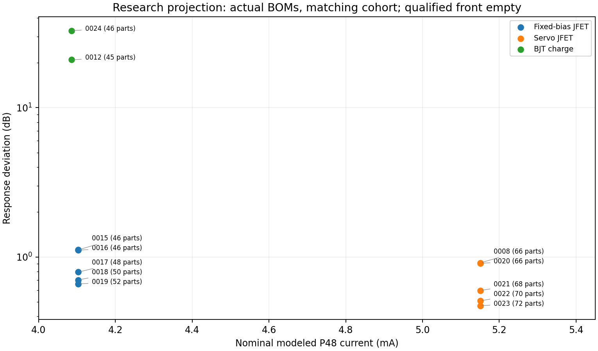

<!-- SPDX-License-Identifier: CERN-OHL-S-2.0 -->
# Meridian architecture comparison 001 — 9 October 2026

**No tested implementation is compelling enough for a prototype selection.** The filtered fixed-bias JFET and discrete servo JFET provide useful, different nominal response results, but miss noise/output or adverse-case requirements and lack validated device populations and nonlinear evidence. The BJT-only charge implementation has a demonstrated conversion/bandwidth problem. Guarded CMOS and CMOS charge integrations fail numerically. The carrier family has an isolated conversion control, but its integrated DUT and periodic noise/power remain unsupported.

This is an intermediate comparison for M100 Meridian MIC-34-M/MIC-34-C with **Arienne Audio Flat K47 Cardioid/Omni K47FRB under P48**. No topology, PCB, physical prototype or production winner is selected. There are no physical measurements. Nominal rear pressure is zero; neither microphone variant's acoustic pattern is qualified. Physics/measurements → SPICE → automated tests → numerical optimization → engineering reasoning → LLM intuition remains the evidence hierarchy.

[Contract](../../CONTRACT.md) · [unchanged specification](../../spec/microphone-spec.yaml) · [capsule assumptions](../../spec/capsule-model.yaml) · [components](../../../../COMPONENTS.md) · [patents](../../../../PATENTS.md) · [measurement priorities](../../measurement/priority-plan.md) · [dated comparison plan](architecture-comparison-001.yaml).

## Audit, comparison scope and reproducibility

The [device validation audit](../devices/device-model-validation.md), [first batch](first-architecture-batch.md), [optimization report](optimization/robust-optimization-report.md), original optimizer trials and full-suite/withheld records were inspected before reporting. Later work already supplies six implemented mechanisms, fifteen first-batch implementations, nine robust children and six budgeted optimization records. Catalogue-only concepts are retained as proposals, not populated with invented metrics. All fourteen families remain in [the family register](../../search/families.yaml).

## Representatives and exact identities

“Representative” means the strongest supported result for a stated niche or the most complete tested implementation of a held mechanism. It does not assert globally optimal or equally qualified architectures. Lower-count alternatives remain visible.

## Power, sensing and no-selection strategy

The common power network harvests both microphone XLR legs through 2.2 kΩ resistors into a raw node, with 47 µF storage and a 100 kΩ/100 kΩ base divider driving a BC846B emitter-follower rail. A separate midrail divider/filter supplies signal references. Ten series ordinary 1 MΩ resistors realize the 10 MΩ polarization filter; a final 1 MΩ feeds the backplate. Loaded rail and electrode voltages are computed with P48 feeds, cable and preamp attached. Device terminal-current/KCL and energy-closure records support nominal power accounting; they do not establish thermal/SOA or hot-plug safety. Output branches use 47 Ω and real coupling capacitors, plus finite preamp/cable loading. No protection-complete implementation exists.

## Nominal performance, contributions and missing nonlinear evidence

All numerical noise entries below are **electronics-only, conditional on the assumed capsule transfer and unvalidated semiconductor spectra**. Mechanical/acoustic capsule noise and overload are absent. Noise band is 20 Hz–20 kHz; output sensitivity is at 1 kHz. “Unknown” denotes failed/unsupported analyses, not zero.

## Loading, interface, startup and adverse evidence

0019/0023 front voltage ratios at 1 kHz are 0.93743/0.91998; nominal loading losses 0.5612/0.7244 dB. Three-port capsule deembedding gives clamped-electrode input C near 2.17/2.67 pF, with approximately 1 nS conductance; raw Y matrices preserve dynamic coupling. BJT's ratio is 0.00065545, but a voltage-buffer loading-loss metric is explicitly null for charge sensing: virtual-ground electrode voltage is not itself lost charge sensitivity. Its failed pressure transfer/response, rather than that ratio alone, is the meaningful rejection of this implementation.

## Where capsule assumptions change the response order

The generator pairs equal named deterministic scenarios and verifies their external parameter dictionaries, rather than pairing random draws or implementation-specific correlated passive cases. Within those finite observations:

## Optimization realization, tolerances and substitutes

Six mechanisms received a declared 12-vector/three-scenario budget, seed 34047. Conventional/servo/BJT consumed all twelve without convergence; CMOS each stopped after one vector/three errors; carrier retained unused budget on periodic prerequisites. No training, solver, threshold or uncertainty budget changed. BJT's best tested infeasible proposal near 7.088 nF/8.457 dB is not a qualified continuous optimum or realized performance claim.

## Procurement, intended quantities and separate costs

Exact variants, per-reference values/grades/ratings/packages and purchasing quantities are reproduced in [the generated BOM tables](../../results/reports/architecture-comparison-001/tables.md), linked to dated supplier records. Ordinary RC/AC 0603 resistors, HVA12JA1G00 axial 1 GΩ, R82 PET film, FR-A radial electrolytics, C0G 0603, JFE150DBVR/OPA197IDBVR SOT-23-5 and BC846B,215 SOT-23 remain documented production research choices. Obtaining every exact part privately in small quantities for Germany is **not yet verified**.

## Separate patent review and affected holds

[The candidate-linked comparison review](../patents/architecture_comparison_001_2026-10-09.yaml) preserves netlist hashes, ancestry, exact feature flags, territorial questions, alternative mechanisms and prototype/manufacture/build-publication holds. **Phase 8 is incomplete. No patent is recorded as screened.** Existing [register](../patents/register.yaml) and earlier feature records contain no actual publication/grant IDs, claim-element mapping or current official territorial status evidence. Prepared queries, technical source reading and this comparison cannot replace that missing research.

## Research fronts and continued investigation

## Validation and preservation

The generator checks reported metrics against original raw spectra, reproduces quadrature power closure, rejects mismatched cohorts and preserves all unknown/error states. New meaningful regressions exercise disjoint noise roots, independent 3–4–12 quadrature, missing-axis dominance rejection, source/backend/spec/suite separation and exact macro/ideal pin connectivity. Laboratory and repository completion results are recorded in [the dated validation receipt](architecture-comparison-001-validation.json).

## Reading and evidence

This compact view retains findings and limits. Consult the [complete original report](../../../../docs/history/2026-10-09/meridian-microphone/lab/research/architecture_comparison_001.md) for all tables, conditions, failures and contemporaneous decisions. [Current evidence hub](../../../../docs/evidence.md) and [scientific contract](../../CONTRACT.md) govern further work. Historical test counts describe the original batch. Current verification is in [repository validation](../../../../docs/validation.md).

## Reading and evidence

This compact view retains findings and limits. Consult the [complete original report](../../../../docs/history/2026-10-09/meridian-microphone/lab/research/architecture_comparison_001.md) for all tables, conditions, failures and contemporaneous decisions. [Current evidence hub](../../../../docs/evidence.md) and [scientific contract](../../CONTRACT.md) govern further work. Historical test counts describe the original batch. Current verification is in [repository validation](../../../../docs/validation.md).

## Reading and evidence

This compact view retains findings and limits. Consult the [complete original report](../../../../docs/history/2026-10-09/meridian-microphone/lab/research/architecture_comparison_001.md) for all tables, conditions, failures and contemporaneous decisions. [Current evidence hub](../../../../docs/evidence.md) and [scientific contract](../../CONTRACT.md) govern further work. Historical test counts describe the original batch. Current verification is in [repository validation](../../../../docs/validation.md).
