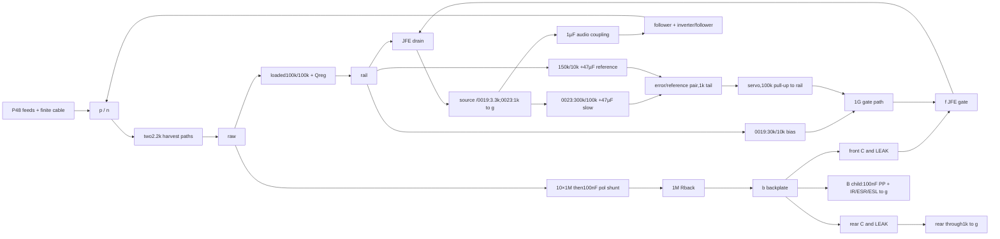

<!-- SPDX-License-Identifier: CERN-OHL-S-2.0 -->
# Independent equations for focused hypotheses 001

Internal model-conditional research. Exact decks/BOMs and frozen model identities control interpretation. These equations do not establish capsule safety, production variation, acoustic performance or stability. [Finite plan](focused-plan-001.yaml), [sources](focused-sources-001.json) and [continuation contract](../prompts/research-workflow.md) retain conditions.

## A: loaded bias and authority

All voltages below are relative to microphone ground, which has finite shield impedance. Let `vR` be rail, `vU` gate-bias/servo output, `vF` front, `vB` backplate, `vRear` rear and `vS` source. Both model diaphragms leak through separate resistances `L=LEAK`; this is not a single shunt to ground. Board leakage `GB` is a separate hypothetical front-to-ground conductance. The actual JFE five-terminal gate current `IG` enters the macro; it is not set to zero or an unrelated typical datasheet value.

DC KCL gives

```
(vF-vU)/RB + (vF-vB)/L + GB*vF + IG = 0
(vB-vRaw)/(Rpolar+Rback) + (vB-vF)/L + (vB-vRear)/L + vB/Rfilm = 0
vRear/Rrear + (vRear-vB)/L = 0
```

`Rpolar=10×1MΩ`, `Rback=1MΩ`, `RB=1GΩ`, `Rrear=1kΩ`. The original filter capacitor is open at DC; the new child's film insulation is not. Solve the complete linear four-node equations with observed nonlinear gate current and raw/rail boundary values. This independent network solution validates KCL/loading, **not** an independent JFE nonlinear law. Retain any residual. Source KCL includes the servo sense load and the complete measured source-terminal current; drain current alone omits gate/clamp currents.

For fixed bias, the additional equation is `(vU-vR)/30k + vU/10k + (vU-vF)/RB=0`. Thus `vU=vR/4-(30k||10k)*(vU-vF)/RB`; no unloaded divider substitution is made. Even before clamp interaction, the gate equation gives `vF=(vU/RB+vB/L-IG)/(1/RB+1/L+GB)`. At `L=1GΩ`, with negligible board/IG, the gate lies halfway between bias output and backplate. A servo must then demand `vU=2*vF-vB`; negative demand can exceed its unipolar authority. Guarding an insulator cannot remove this unavoidable capsule discharge path. [Keithley §§2.2–2.3](https://download.tek.com/document/LowLevelHandbook_7Ed.pdf) motivates the separate board hypothesis; no electrometer performance is transferred.

For servo0023, the reference uses150k above10k, and the sense path300k above100k:

```
vSet = vR/16 - 9.375k*IBref
vSlow = vS/4 - 75k*IBerror
vServo = vR - 100k*ICerror - 100k*(vServo-vF)/RB
IEerror + IEref = vSE/1k
```

Signs in the third equation take collector/input currents positive into their devices. Equality of `vSlow` and `vSet` is a high-gain approximation, not an ideal constraint. Unequal base currents, finite differential voltage and tail/saturation behavior change the source target. The unloaded target `vS=vR/4` would set `IS=vR/(4*1k)`, before the300k sense current. The sense pole is `75k*47µF=3.525s`; reference pole `9.375k*47µF=0.4406s`. The servo is a finite differential-pair pull-down against100k, without ideal integration or arbitrary negative output. Collector-to-emitter voltage, gate/source/drain ordering and terminal current are recorded. Loss of active-region authority, static rating violations and bad response remain separate failures.

The regulator also loads its divider: `(vRegBase-vRaw)/100k+vRegBase/100k+IBreg=0`, so `vRegBase=vRaw/2-50k*IBreg`, and the emitter rail is lower by the actual `VBE`. Rail load is coupled to output/base/servo current, not an independent13.56V supply in the full DUT. P48 each-leg current follows the actual feed/cable/harvest network. For a balanced approximation only, `vRaw≈VS-I*(6.8k+Rwire+2.2k)/2`; unequal output capacitor leakage/feed impedance invalidates that simplification. Exact full-DUT KCL and energy accounting retain the nonlinear dependencies.

[JFE150 table6.5](https://www.ti.com/lit/ds/symlink/jfe150.pdf) ties gate-current and DC limits to specific bias/clamp/temperature conditions. At1GΩ,10pA is10mV; the separate2000pA high-temperature bound is2V. These are condition-specific error scales, not substituted measured currents at the DUT bias. Known full weak/strong model guarantee disagreements and the uncovered Shockley24mA range remain. No finite artificial grid establishes a useful *production* no-selection region.

## B: final backplate filtering

Use a final shunt on `b`, downstream of `Rback`; shunting `pol` already exists and cannot suppress noise generated by `Rback` itself. The unfiltered parent and fixed-bias0019 remain controls. For small-signal passive analysis let `Gp=1/Rpolar`, `Gb=1/Rback`, `Yb` include the loaded two-electrode capsule/servo driving-point admittance and the film equivalent, and `Cp=Cpol`. Then

```
[ Gp+Gb+s*Cp   -Gb        ] [vPol] = [Gp*vRaw + iPol]
[ -Gb          Gb+Yb     ] [vB  ]   [iB             ]
D=(Gp+Gb+s*Cp)*(Gb+Yb)-Gb²
Hraw->B = Gp*Gb/D
Hcurrent_at_B->B = (Gp+Gb+s*Cp)/D
```

The resistor between `pol` and `b` injects *opposite correlated* Norton currents at the two nodes, so its transfer is `(Gp+s*Cp)/D`, with PSD `4kT/Rback`. The two sources must not be squared independently. The film branch is `Yfilm=1/RIR+1/(RESR+s*LESL+1/(s*C))`. Constant ESR/IR models are supplemental assumptions; their native Johnson terms are retained. Unknown dielectric/excess/temperature laws receive no zero-noise qualification.

With the upstream node AC stiff and negligible capsule load, the one-pole check is `H=1/(1+s*Rback*C)`.100nF gives1.59155Hz pole,22.012dB attenuation at20Hz and0.46052s to1% for this *single* pole. Charging energy at30V is45µJ. The complete upstream10MΩ/100nF pole and servo/capsule loading require actual startup, rather than adding time constants as a settling proof. The independent20Hz–20kHz resistor-noise integral is `2kT/(πC)*(atan(2πRC*fhi)-atan(2πRC*flo))`; adaptive quadrature checks units/normalization. Numerical thermal closure cannot validate missing spectra.

[WIMA MKP2](https://www.wima.de/wp-content/uploads/media/e_WIMA_MKP_2.pdf) identifies the exact100nF±10%,100V PP variant with5mm pitch and5×10×7.2mm body.20°C IR≥100GΩ and1kHz DF≤0.0005 give a *constant-law diagnostic* ESR0.795775Ω. Nominal uses that adverse IR/DF endpoint;10–50nH is an assumed ESL range. Neither discrete limit supplies a temperature/noise law. One added physical part occupies36mm² body projection/360mm³ before pads/clearance. No approved capsule voltage follows from the capacitor's100V rating.

## C: finite two-port driver

The actual driver is a follower on the positive conductor; the negative conductor follows an emitter-degenerated common-emitter inverter. Both have47Ω output series resistors and four independent47µF coupling parts, with their own loss/leakage branches. Signal bias comes through1MΩ from the loaded rail midpoint. There is no symmetric dual amplifier.

For a local hybrid-pi derivation at the *actual operating point*, `gm=IC/VT`, `rπ=β/gm`, `ro=1/go`, and capacitances/base-spreading resistance retain frequency and bias dependence. At each transistor, base KCL contains `(vb-ve)/rπ+s*Cπ*(vb-ve)+s*Cµ*(vb-vc)`; collector KCL contains `gm*(vb-ve)+go*(vc-ve)+s*Cµ*(vc-vb)` and emitter KCL closes the currents. Stamp all three transistors, midpoint/source impedance, inversion10k emitter/collector, output loads and coupling equivalents into `Y(s)`. Eliminating internal nodes gives `Yports=Ypp-Ypi*Yii^-1*Yip`, `Zports=Yports^-1`. Full-file SPICE retains the vendor's additional quasi-saturation/series networks; a simplified pi model is an equation oracle, not imported device performance.

At low frequency, the follower's port impedance roughly includes `47Ω+[1/gm+Zbase/(β+1)]`, while the negative follower sees an inverter collector impedance and different DC current. The inverter gain is approximately `-gm*(RC||ro||Zinput_negative)/(1+gm*RE)` with finite-beta correction. Its loaded collector and changing beta explain why equal47Ω labels cannot imply equal ports or exact phase inversion. Thermal/self-heating/SOA, reverseBE/protection and missing KF remain unresolved for all three full model identities.

For `d=[1,-1]`, differential impedance is `dᵀZd`; conductor mismatch uses diagonal difference over mean diagonal magnitude; common-current conversion is `dᵀZ[1,1]`. These are distinct quantities. Exact2×2 inverse/determinant oracles are retained. The isolated fixture includes finite source/100m cable/preamp/P48 feeds/harvest, but holds rail/raw at parent DC values to isolate drivers. It reports loaded port matrices; the complete microphone suite separately deembeds environment admittance. No unloaded matrix or intrinsic CMRR is invented.

Independent stochastic resistor/device sources contribute `Sout=Σ|Hk|²Sk`. A common supply disturbance contributes `|Hp-Hn|²*Srail`, not `(|Hp|²+|Hn|²)*Srail`; record its coherent complex transfer separately. [THAT receiver discussion p5](https://thatcorp.com/datashts/1200data.pdf) motivates finite endpoint and source-impedance tests. [THAT driver p9](https://www.thatcorp.com/datashts/1600data.pdf) motivates capacitor-energy/hot-plug/RF gaps; its IC performance/protection is not transferred to these BJTs.

BC850C and PMBT5551 use their own complete Nexperia files. The high-voltage NPN has a warranted P48 withstand *research role* but does not solve an internally13.56V driver's noise by rating alone. PNP MMBT5401, unmatched dual packages, Diotec unsupported terms and floating OPA macros are retained leads, not substitutions into this NPN circuit. Prompt8 does not support integrated harmonics/headroom, so no such comparison is credited.

## Faithful connectivity views

These compact diagrams show signal/bias paths; exact preserved netlists also include every zero-volt terminal observer and equivalent loss/insulation branch.



## Loop and failure boundaries

The sense-path zero-DC voltage-injection child preserves operating bias and observes `-vReturn/vDrive`; [Middlebrook methodology](https://iic-jku.github.io/analog-circuit-design/slides/middlebrook_method.html) requires attention to loading and bilateral paths. This diagnostic cannot supply a complete multiple-loop Nyquist proof without current injection/open-loop pole evidence. Static saturation can invalidate a small-signal return trace before any margin calculation. Fixed bias still contains transistor/supply/audio feedback paths. Closed-loop response, noise reduction and a converged AC trace never pass that gate.

Cold startup and a44V/48V supply recovery observation use the existing5s/60s budgets. All raw failures and incomplete final settling remain. Every child receives the full applicable suite and independent retained adverse tests; no new family, production front or PCB is selected.

## Cohort and ancestry

The original0017/0019/0023 netlist hashes still match their frozen robust records. Read-only comparison001 auditing verified9117 declared source/implementation/job hashes. Original0017 (`20261009T090650Z_595690f6`) has two47µF capacitors per output leg;0019 (`20261009T090737Z_40e6a493`) and0023 (`20261009T090930Z_1acba093`) have four. Those cohorts, full-suite failures and independent robust holdouts remain separate from this experiment.

Sources, specifications, backend/code-model bytes, models, passive assumptions and each implementation were frozen. The complete-suite seed/sample count is identical across the three candidates. Independent holdouts use common external values and common relative tolerance quantiles. **0019 has3.3kΩ source degeneration;0023/0025 have1kΩ.** Their own ±1% ranges are retained, not forced into an identical population. B alone changes the final-backplate filter, preserving every original0023 value/model. This is an actual-circuit comparison, not an isolated proof that feedback alone causes every A difference.
