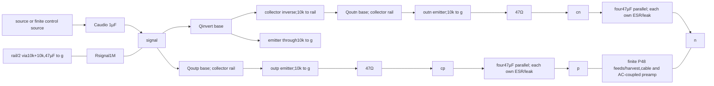

<!-- SPDX-License-Identifier: CERN-OHL-S-2.0 -->
# Actual output-driver connections

[Derivation](focused-derivations-001.md) · [Executed controls](focused-hypotheses-001.md#c--isolated-realized-drivers)

This connectivity view follows the0023 driver body, retained by0025 and the three isolated transistor variants. Values are realized nominal parts; every complete DUT also retains its source/regulator/servo network. Each BJT has finite manufacturer model behavior and zero-volt terminal observers in the exact frozen deck.

Emitter arrows show connectivity, not a promise of unit gain. Inversion includes finite10k emitter degeneration, base current and collector loading. Isolated controls retain coupled supply transfer but hold rail/raw at declared ideal diagnostic boundaries; complete DUTs contain the actual loaded regulator. Port matrices retain both diagonal and cross terms. No intrinsic CMRR, hot-plug or stability proof follows from this diagram.

## Isolated control conditions

The actual follower/inverter/follower network has unequal DC currents/base impedances. Full2×2 port injection preserves cross terms. A separate100Ω/130Ω/2kΩ bilateral oracle agrees with the analytic inverse within2.9×10⁻¹⁴Ω. Differential impedance, conductor mismatch and common-current conversion are distinct; equal47Ω output labels do not make the ports equal. Finite100m cable, preamp coupling/load asymmetry and6.8kΩ P48 feed mismatch remain in the fixture.

The isolated fixture holds rail13.5557796V and raw29.5293276V. An original code comment incorrectly named the servo parent: these are diagnostic values near0019, with raw0.612mV below its actual raw node. The frozen decks preserve the true conditions; the correction changes interpretation, not results. The rail/raw ideal boundaries omit integrated regulator feedback, and native totals include fixture noise. Coherent complex rail transfer retains cancellation before squaring; source covariance remains a separate unknown. Fixture conversion is not intrinsic CMRR.

Three rail-only startup controls complete, but end with38–62mV output-node residuals in the high-source-impedance fixture; they are not P48 hot-plug or full-DUT startup qualification. Thermal/SOA, protection, distributed RF, process spread and complete noise spectra remain missing. Prompt8 supports isolated follower harmonics only; microphone distortion errors/headroom incompleteness remain.
