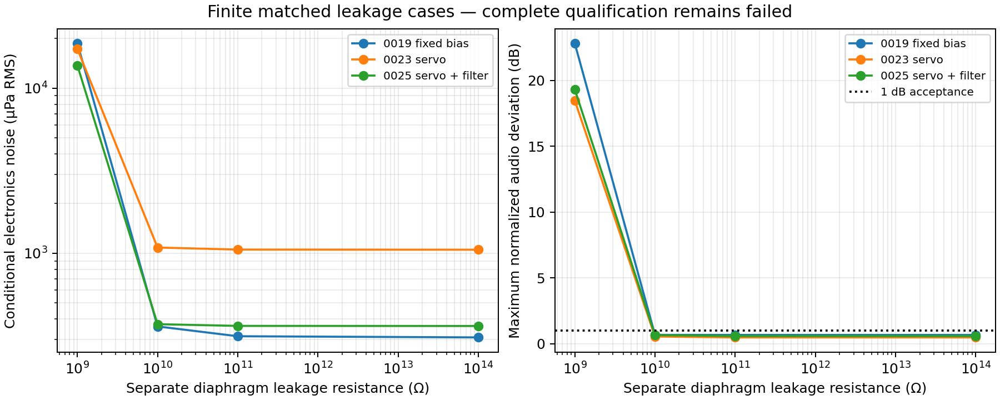

<!-- SPDX-License-Identifier: CERN-OHL-S-2.0 -->
# Bias authority, final-backplate filtering and output drivers — 001

Completed 12 October 2026; experiments and sourcing observations dated 11 October. Prompt9 is executed as finite research. **0025**, the actual filtered child of0023, reduces conditional nominal electronics noise from1052 to363µPa RMS, but neither JFET topology controls the retained1GΩ leakage case. Both ordinary driver alternatives have a retained noise/balance tradeoff. Every complete microphone suite remains failed; production and physical fronts are empty. No topology, prototype or PCB is selected.

## Evidence and cohort

[Plan](focused-plan-001.yaml) separates A/B/C, seeds94047/104047, stopping rules and prerequisites. [Derivations and connectivity](focused-derivations-001.md), [driver diagram](focused-driver-diagram-001.md), [source receipts](focused-sources-001.json), [20-query research log](focused-queries-001.json), [parts](../procurement/focused-parts-001.yaml) and [patent feature inspection](../patents/focused-hypotheses-001.yaml) provide conditions rather than transferred product performance.

The later-child audit found0024 to be a BJT descendant; no existing filtered0023 child was found. Existing mutation registration created0025. [Child/version register](focused-children-001.json) preserves the exact parent and7 active devices; one physical WIMA part adds equivalent IR/ESR/ESL branches. No output-capacitance optimization was performed. All14 families remain.

Original0017/0019/0023 circuits still match their frozen robust records; read-only auditing verified9117 declared hashes. [Exact ancestry and cohort limits](focused-derivations-001.md#cohort-and-ancestry) keep earlier evidence separate.

| Current evidence | Scope |
| --- | --- |
| [Primary frozen cohort](../../results/mechanism_controls/20261011T192308Z_focused_1992e85a/results.json) |90 A/B cells, three complete14-check suites, recovery/return diagnostics and60 isolated-driver/oracle jobs; source unchanged true |
| [Follow-up controls](../../results/mechanism_controls/20261011T192658Z_focused_followup_b5cac5a2/results.json) |Three repaired board extractions, six remaining+50°C TCR cases, three two-node oracles and two injection-orientation checks; source unchanged true |
| [Machine tables and coverage](../../results/reports/focused-hypotheses-001/INDEX.md) |Hypotheses,42 checks,99 retained cells,DC authority,nominal values and separate empty qualified fronts |

The matched cohort freezes source/model/spec/backend bytes. Common external values and tolerance quantiles preserve each actual design:0019 retains3.3kΩ source degeneration;0023/0025 retain1kΩ. Only B isolates a single structural filter addition. [Full matching conditions](focused-derivations-001.md#cohort-and-ancestry) preserve the different ranges.

## A — no-trim authority

The four-node DC oracle retains observed nonlinear JFE gate current, loaded rail/raw boundaries, separate front/rear discharge paths, bias-network loading and the new film's insulation. It independently solves the passive network; it does not independently validate the vendor's semiconductor law. Node disagreement is below43fV for the parents and27nV for the child; the latter includes numerical/model conductance effects. Source KCL includes sense loading and measured source-terminal current, rather than equating drain and source currents.

| Nominal /1GΩ case |0019 fixed bias |0023 servo |0025 filtered servo |
| --- | --- | --- | --- |
| Source current, mA |1.277 /3.172 |2.948 /5.970 |2.948 /5.970 |
| Rail, V |13.556 /10.535 |11.010 /6.094 |11.010 /6.094 |
| JFE VDS, V |9.341 /0.066 |8.063 /0.124 |8.063 /0.124 |
| JFE VGS, V |−0.785 /+0.290 |−0.676 /+0.332 |−0.676 /+0.332 |
| Audio deviation, dB |0.659 /22.808 |0.472 /18.462 |0.573 /19.308 |
|1GΩ full authority claim |Falsified |Falsified |Falsified |

At1GΩ the two diaphragm discharge paths load polarization, and the front path competes directly with the1GΩ gate-bias resistor. The front voltage moves toward the backplate. The fixed divider cannot counter that rise; the servo's pull-down reaches saturation: its output falls2.235→0.091V and error-transistor VCE falls2.108→0.020V. It cannot provide the required negative gate correction. JFE gate/source ordering reverses and drain/source voltage collapses; a converged DC point is not active-channel authority. The high source current further loads P48 harvesting and lowers the rail. No leakage case is discarded.

Nominal servo source voltage is0.195V above the unloaded rail/4 target. At1GΩ this error is4.446V. Finite base currents and unequal loaded reference/sense dividers explain why the unloaded target is not an ideal servo constraint. The analytical sense/reference time constants are3.525/0.4406s, with finite differential-pair gain and100kΩ pull-up. This is not an ideal integrator.

All three circuits have useful **tested local** DC/response cells at10GΩ,100GΩ and100TΩ with nominal external conditions. That establishes neither a continuous authority boundary nor a no-selection manufacturing region. Coupled weak/strong complete files, ±supply/temperature/interface cases and documented tolerance/TCR endpoints retain nonlinear dependencies. Nominal variation and guaranteed device coverage are still incomplete, including the prior uncovered24mA Shockley range.

The independent16-case holdout gives15/16 supported DC/response passes for0019,6/16 for0023 and15/16 for0025. These are artificial paired stress counts, not yield. The shared low-supply/long-cable/low-load case fails all three; high parasitics/low capsule capacitances fail0023 while0019/0025 pass. Separate100GΩ board contamination plus1GΩ capsule leakage still fails after correcting extraction typing. Board contamination is not silently merged into a claimed capsule rating.

No structural A remedy is registered: the supported failure requires more gate authority or a different leakage/bias relationship, while a negative supply, extra active stage or changed bias resistance lacks independently validated noise/startup/device evidence here. No hidden trimming or specimen matching is used.

## B — realized filter benefit and regressions

[0025's exact BOM](../../candidates/candidate_0025/bom.yaml) adds WIMA **MKP2D031001F00KSSD**,100nF ±10%,100V metallized polypropylene, radial5×10×7.2mm with5mm pitch. Manufacturer20°C insulation/1kHz dissipation conditions anchor the model. Nominal IR is100GΩ, ESR0.7958Ω and assumed ESL30nH; explicit stress ranges retain IR100GΩ–100TΩ, ESR0.01–0.7958Ω and ESL10–50nH. Constant laws are supplemental assumptions, not measured broadband/temperature/excess-noise bounds.

The two-node polarization determinant includes the existing10MΩ/100nF filter and final1MΩ branch. Rback injects correlated opposite Norton currents into the two nodes; squaring two independent contributions would be wrong. Independent filtered/unfiltered network transfer checks, including loss/insulation/inductance and the adverse filter endpoint, agree with SPICE to1.9×10⁻⁹ relative. The simpler1MΩ/100nF oracle has a1.592Hz pole,22.01dB attenuation at20Hz,0.461s unloaded1% settling and45µJ energy at30V. Those are local diagnostics, not full-DUT settling or approved capsule bias.

| Nominal matched result |0019 |0023 |0025 |
| --- | --- | --- | --- |
| Conditional20Hz–20kHz noise, µPa RMS |309.84 |1051.66 |362.76 |
| Audio deviation, dB |0.659 |0.472 |0.573 |
| P48 current, mA |4.104 |5.150 |5.150 |
| Front polarization, V |26.100 |22.546 |22.543 |

0025 reduces conditional RMS noise by65.51% (9.25dB). Rback dominates the unfiltered parent at979µPa RMS. Filtering exposes the bias resistor (275µPa), inversion collector/emitter resistors (139/137µPa) and negative-output transistor (94µPa) as larger residual terms. [Native contribution table](../../results/reports/focused-hypotheses-001/nominal-noise-contributions.json) retains every root and film loss/insulation term. Electronics accounting excludes the capsule/fixture terms; numerical noise-power closure is at floating-point precision. Missing spectra remain unqualified, so these are not measured acoustic self-noise figures.

Nominal response worsens0.101dB, but remains within1dB. At1GΩ the conditional noise falls17.29→13.75mPa RMS while response worsens18.462→19.308dB; that failed-bias comparison grants no usable microphone improvement. High-parasitic capsule response improves1.903→0.578dB; the low-supply case worsens2.738→2.850dB and still fails. [Every matched pair](../../results/reports/focused-hypotheses-001/filter-pairs.csv) retains adverse values rather than selecting nominal successes.

Lines connect only four tested leakage points; no interpolated authority or population claim follows. [SVG export](../../results/reports/focused-hypotheses-001/leakage.svg) retains vector output.

AC32→64 points/decade changes nominal deviation by at most0.00195dB. Noise64→128 changes RMS by at most0.0179%; these are observed refinement deltas, not complete error bars. RC transient step halving reduces oracle error12.1→3.05µV. The large filter benefit is resolved against these controls; tiny balance/current differences receive no practical improvement claim.

The added radial part needs area/mounting; no PCB exists. The11October retail observation is€0.55 including19%VAT with2–5 working days, but seller details contradict the manufacturer suffix. [Exact sourcing record](../procurement/focused-parts-001.yaml) retains that conflict, indexed backorders and unknown shipping/pack/delivered cost. Parent costs stay partial; no purchase follows.

## Startup, recovery and loop evidence

The complete suite's supported P48 cold-start screen passes0019 at4.260s. Both servo cases reach the5s observation edge with final rail values10.735/10.728V against11.010V DC targets and **fail**, rather than receiving5s settling credit. Hot-plug and asymmetric connection are unsupported. The pressure-free48→44→48V recovery attempts for all three DUTs fail with retained timestep-too-small logs/waveforms; no recovery or harmonic estimate is extracted from those prefixes.

Zero-DC sense-path injection preserves the operating point. Reversing the voltage-source orientation gives identical return diagnostics for both servo cases. Multiple unity crossings occur around0.14,1.15 and2Hz; low-frequency diagnostic magnitude is≈2.916. The final filter slightly shifts the crossings. Bilateral current injection, complete open-loop RHP pole counts and a multiple-loop criterion are not validated, so neither this trace nor quiet closed-loop AC supplies phase-margin/Nyquist proof. Stability stays failed/incomplete.

## C — isolated realized drivers

[Driver table](../../results/reports/focused-hypotheses-001/drivers.csv) compares the repaired BC846B model with each part's own complete Nexperia BC850C and PMBT5551 files: three temperatures(−10,25,50°C), three finite source/load fixtures,27 cells. No beta/capacitance/leakage or noise law is borrowed between manufacturers. [Per-reference driver BOMs](../procurement/focused-driver-boms-001.yaml) preserve all coupling counts and ordinary standard parts. High voltage is a role/rating fact, not a noise advantage.

The full2×2 matrices and independent bilateral oracle retain unequal base impedances and supply paths; [detailed conditions](focused-driver-diagram-001.md#isolated-control-conditions) distinguish loaded ports from deembedded DUT quantities.

|25°C nominal isolated fixture |BC846B |BC850C |PMBT5551 |
| --- | --- | --- | --- |
| Total native output noise, µV RMS |2.770 |2.701 |2.955 |
| Loaded differential impedance maximum, Ω |223.50 |203.60 |278.84 |
| Loaded conductor mismatch maximum |16.28% |13.14% |23.17% |
| Coherent common-rail→differential gain at1kHz |0.835 |0.850 |0.794 |

BC850C improves nominal port mismatch and native total output noise, but at100kΩ source impedance noise worsens4.20%,2.16% and0.91% at−10/25/50°C. PMBT5551 reduces noise in that fixture but worsens imbalance; its nominal noise also rises6.66%. Neither meets the predeclared simultaneous supported-screen condition. No integrated C child is made and no complete microphone performance is inferred from isolated totals.

The rail/raw boundaries are held diagnostic values near0019; the frozen comment incorrectly named0023. Total native noise includes fixture terms. Rail-only startup ends with38–62mV residuals; hot-plug, thermal/SOA, protection, distributed RF and complete process/noise spectra remain unsupported. [Conditions and corrected interpretation](focused-driver-diagram-001.md#isolated-control-conditions) preserve those limitations.

## Full checks and completion

All three full suites pass supported operating-point/nominal response/phantom/temperature screens, fail noise/output impedance/balance/loading/stability, retain distortion errors and incomplete headroom/device-corner/Monte-Carlo coverage. Only0019 passes supported startup. [Coverage](../../results/reports/focused-hypotheses-001/coverage.json) records the exact distinction between executable checks and behavioral qualification.

[Two official grant inspections](../patents/focused-hypotheses-001.yaml) find preliminary literal feature differences forEP1585365B1/EP2590434B1. The EPO status retrieval failed; broader claims, families/equivalents and official status remain unresolved. This is no clearance; prototype/manufacture/build-publication holds remain. No source schematic or vendor performance was transferred.

Three preflight/partial cohorts preserve the binary-as-text, incompatible-source-resistor-range and YAML-numeric-type failures. Original board extraction errors remain beside separately declared successors. Source retrieval also preserves DNS/HTTP failures and private original notices. See [integrity and original-byte limitations](focused-integrity-001.json) and [completion validation](../../../../docs/validation/2026-10-12-focused-hypotheses.md).

Reproduce tables without simulation using `.venv/bin/python tools/reporting/focused_report.py` from the lab. New experiments use `tools/controls/focused_hypotheses.py`; existing preparation refuses duplicate registration. Raw waveforms/vendor originals stay local and ignored, with inventories and hashes; committed snapshots/decks/logs/compact results can follow the GitHub storage policy. No publication or commit was authorized here.

The next supported work is bilateral loop/control validation and a separately planned leakage-authority remedy, retaining the original capsule/device envelope. Full nonlinear prerequisites, actual capsule safety, joint device evidence, exact delivered sourcing and candidate patent status still precede qualification or selection.
