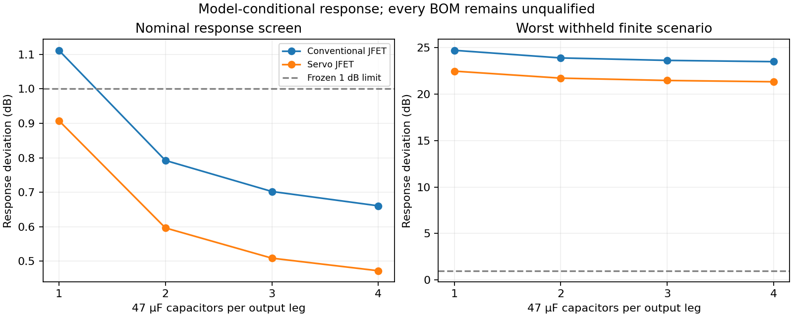

# Robust optimization: derived evidence

[Maintained findings](../../../research/architectures/optimization/robust-optimization-report.md)
· [Frozen batch](../../optimization_batches/20261009T090126Z_4735cd2a/evaluation.json)

[Budgets](budgets.csv) · [Continuous proposals](continuous.csv) · [Actual BOMs](implementations.csv)

Every implementation is unqualified. Random intervals describe an assumed sampler,
not production yield. Costs are incomplete catalogue scenarios; delivered totals remain unknown.

